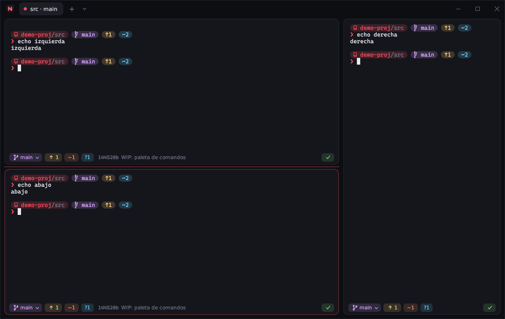
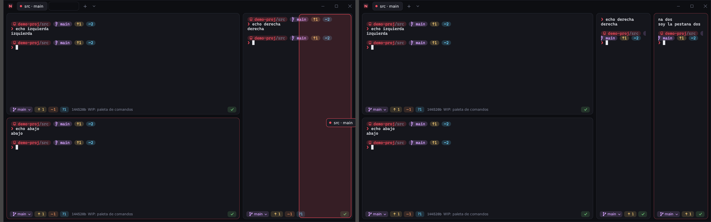
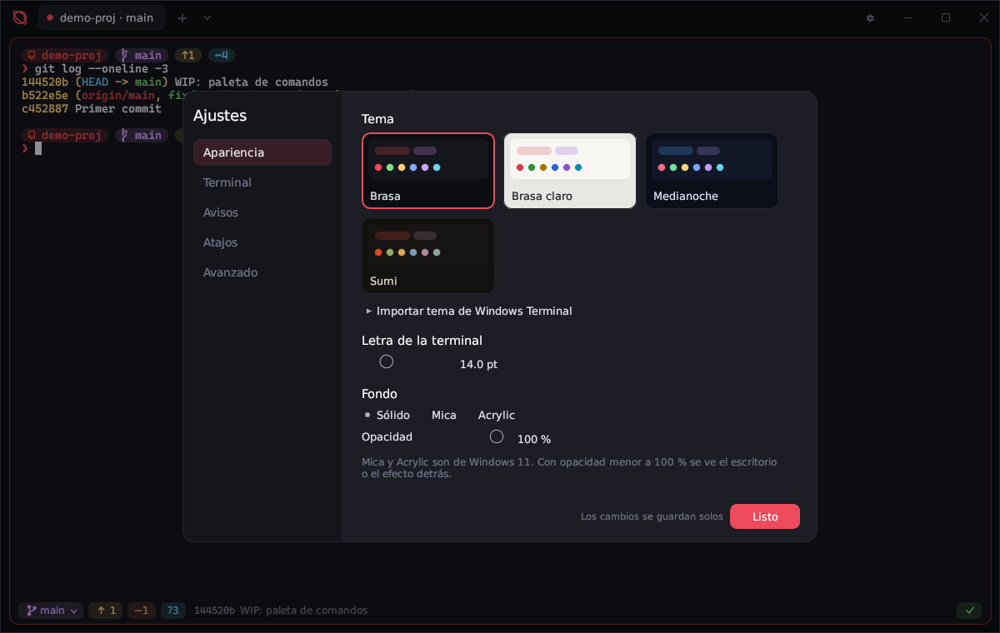

# Neon


Una terminal propia en Rust con un diseño moderno al estilo Warp, llamado **Brasa**: fondo grafito,
paneles flotantes, rojo brasa como acento y texto a color. Tiene pestañas que se arrastran entre
ventanas, paneles divididos, paleta de comandos, historial con la flecha ↑, perfiles de shell
(PowerShell, cmd, Git Bash, WSL), sesión que se restaura e indicador de git.



## Compilar e instalar (Windows)

Necesitas Rust ([rustup](https://rustup.rs), con las *Build Tools* de Visual Studio) y `git`.

### Con el instalador (recomendado)

```powershell
.\build-installer.cmd
```

Compila Neon y genera **`dist\NeonSetup.exe`**. Ese `.exe` lo puedes llevar a otro PC.


El instalador tiene tres pantallas:

- **Bienvenida** (primera vez): casillas para elegir qué integrar (acceso directo en el escritorio y
  en el menú Inicio, «Abrir en Neon» en el click derecho, `neon` en el Explorador y `Win+R`, y abrir
  Neon al terminar) y el botón **Instalar**.
- **Ya instalado**: muestra la versión instalada y ofrece **Actualizar** (si este instalador trae una
  versión más nueva) o **Reparar** (vuelve a copiar Neon y a registrar todo según las casillas), y
  **Desinstalar**.
- **Desinstalar** pide confirmación y tiene la casilla *Borrar también mi historial y ajustes*
  (apagada por defecto: sin marcarla, `%LOCALAPPDATA%\neon` se conserva).

Lo que deja instalado:

- Neon en el menú Inicio y, si quieres, un acceso directo en el escritorio.
- `neon` en la barra de direcciones del Explorador (y en `Win+R`): abre Neon en esa carpeta.
- **Abrir en Neon** al hacer click derecho en una carpeta (en Windows 11, dentro de
  "Mostrar más opciones" o con `Shift` + click derecho).
- Una entrada en **Configuración → Aplicaciones**, con su botón Desinstalar.

Todo es solo para tu usuario: no pide administrador. Para actualizar, vuelve a correr el
script y abre el nuevo `NeonSetup.exe` (funciona aunque Neon esté abierto). Las casillas describen
cómo debe quedar la integración: lo que desmarques en Reparar se quita.

### Sin instalador

```powershell
cargo build --release
.\target\release\neon.exe --instalar      # opcional: --escritorio --sin-inicio --sin-menu --sin-explorador
```

Para desinstalar: desde Configuración → Aplicaciones, o `neon --desinstalar`
(`--borrar-datos` borra también el historial y los ajustes; sin eso, `%LOCALAPPDATA%\neon` se conserva).

## Atajos

| Atajo | Acción |
|---|---|
| `Ctrl+Shift+P` | Paleta de comandos (todas las acciones, buscando por nombre) |
| `Ctrl+,` | Ajustes (temas, letra, fondo, avisos, atajos) |
| `Ctrl+Shift+F` | Buscar en la salida (`Enter` anterior · `Shift+Enter` siguiente · `Esc` cerrar) |
| `Ctrl+↑` / `Ctrl+↓` | Saltar al prompt anterior / siguiente |
| `Ctrl+Shift+T` | Nueva pestaña (en la misma carpeta) |
| `Ctrl+Shift+W` | Cerrar panel |
| `Ctrl+Shift+N` | Nueva ventana |
| `Ctrl+Tab` / `Ctrl+Shift+Tab` | Pestaña siguiente / anterior |
| `Ctrl+1` … `Ctrl+9` | Ir a la pestaña 1–8 (`Ctrl+9` = la última) |
| `Ctrl+Shift+D` / `Ctrl+Shift+E` | Dividir a la derecha / hacia abajo |
| `Alt+←↑↓→` | Mover el foco al panel de al lado |
| `Alt+Shift+←↑↓→` | Agrandar / achicar el panel |
| `Ctrl+Shift+Enter` | Maximizar / restaurar el panel |
| `Ctrl+=` / `Ctrl+-` / `Ctrl+0` | Letra más grande / más chica / normal |
| `Ctrl+Shift+C` / `Ctrl+Shift+V` | Copiar / pegar |
| `Ctrl+Shift+O` | Copiar la salida del último comando |
| `↑` en el prompt | Historial junto al cursor (lo de esta carpeta primero, luego por fecha) |
| `Ctrl+R` | Buscador de historial (busca por prefijo, texto o letras sueltas) |
| En el historial | `↑`/`↓` moverse · `Enter` ejecutar · `Tab` dejarlo escrito para editar · `Esc` cerrar |
| `Ctrl+click` | Abrir un link, o un archivo (`src/app.rs:120` abre VS Code en esa línea) |

Con el mouse, en las pestañas:

- **Click** para cambiarte, **click medio** para cerrar, **doble click** para renombrar.
- **Click derecho**: renombrar, elegir color, **Dividir con…** (junta otra pestaña abierta con
  esta, a la derecha o abajo), mover a una ventana nueva o cerrar. Lo mismo está en la paleta:
  escribe `dividir con`.
- **Arrastrar** una pestaña:
  - sobre la barra de pestañas (de esta u otra ventana): la mueve ahí;
  - sobre un panel: se pega a ese lado como una división (se marca en rojo dónde caería);
  - fuera de todas las ventanas: se abre en una ventana nueva, donde la sueltes.
- **`+`** abre una pestaña con la shell predeterminada; la flechita **▾** de al lado deja elegir
  PowerShell, Símbolo del sistema, Git Bash o WSL (los que tengas instalados).

Todos estos atajos se pueden cambiar en **Ajustes → Atajos** (click en el atajo y presionas la
combinación nueva; avisa si choca con otro).

**Click derecho dentro de la terminal**: copiar, pegar, buscar, dividir, limpiar y cerrar panel.

Escribir `exit` en un panel también lo cierra. Si cierras un panel, pestaña o ventana con un
comando todavía corriendo, Neon pregunta antes (se puede desactivar en Ajustes → Avisos).

La ventana no usa la barra de título de Windows (en Windows 11 tiene esquinas redondeadas y
sombra): minimizar, maximizar y cerrar están a la derecha de la barra de pestañas. Arrastra el
espacio vacío de esa barra para mover la ventana, haz doble click para maximizar, y estira desde
cualquier borde para cambiar el tamaño.





## Qué hace cada cosa

- **Historial**: cada comando que ejecutas se guarda en SQLite
  (`%LOCALAPPDATA%\neon\history.db`) con carpeta, repo, si falló y cuánto tardó. Es compartido
  entre ventanas.
- **Flecha ↑**: si el prompt está vacío muestra tus últimos comandos; si ya escribiste algo
  (por ejemplo `git`), filtra por eso. Mientras corre un programa (vim, ssh, un servidor, Python…)
  la flecha le llega a ese programa como siempre. Elegir un comando reemplaza lo que había en la línea.
- **Prompt**: dentro de un repo muestra el nombre del proyecto (en rojo) y la subcarpeta, la rama,
  commits por subir/bajar y cuántos archivos cambiaron, en cápsulas redondeadas con íconos. Fuera
  de un repo, la carpeta abreviada. Funciona igual en PowerShell, Git Bash y WSL.
- **Colores**: PowerShell colorea
  lo que escribes (comando en rojo, opciones en cian, textos en verde, variables en violeta).
  Si usas oh-my-posh o starship, se respeta tu prompt; para desactivar el nuestro, define
  `NEON_PROMPT=0`. Además aparecen sugerencias en gris mientras escribes (→ para aceptar).
- **Git**: la barra inferior de cada panel muestra cápsulas con la rama, commits por subir/bajar
  (↑ ↓), archivos en stage (+), modificados (~), sin seguimiento (?) y conflictos (!). Click en la
  rama abre un menú para cambiar de rama o ver los últimos commits.
- **Sesión**: al cerrar se guardan ventanas, pestañas, divisiones, carpetas, nombres y colores, y
  se recrean al abrir Neon desde el menú Inicio o la barra de tareas. Si lo abres desde el
  Explorador (`neon` en la barra o "Abrir en Neon") abre solo esa carpeta y no toca la sesión.
- **Avisos**: si un comando tarda más de 10 segundos y no lo estás mirando (otra pestaña u otra
  ventana), al terminar aparece una notificación de Windows y parpadea Neon en la barra de tareas.
  Instalado con NeonSetup, la notificación sale con el nombre y el ícono de Neon.
- **Buscar**: `Ctrl+Shift+F` abre una barra arriba del panel; resalta todas las coincidencias
  (la actual en rojo), muestra `3/12` y marca su posición en la barra de scroll. Si tenías texto
  seleccionado, lo usa como búsqueda.
- **Scroll**: barra fina que aparece al desplazarte y se puede arrastrar; `Ctrl+↑`/`Ctrl+↓` saltan
  entre los prompts de los comandos anteriores.
- **Ajustes** (`Ctrl+,` o el engranaje de arriba): se guardan solos en
  `%LOCALAPPDATA%\neon\settings.toml`. También puedes editar ese archivo a mano: Neon lo recarga
  al guardarlo.
  - **Temas**: Brasa, Brasa claro, Medianoche y Sumi. Puedes **importar un tema de Windows
    Terminal**: pega el bloque JSON del esquema (`"name": …, "background": …, "red": …`).
  - **Fondo**: Sólido, Mica o Acrylic (Windows 11) y opacidad de la terminal.
  - **Terminal**: shell predeterminada, líneas de scrollback, restaurar sesión, prompt de Neon.
  - **Avisos**: notificaciones al terminar y después de cuántos segundos, confirmar al cerrar.
- **Copiar salida**: `Ctrl+Shift+O` copia lo que imprimió el último comando, sin el prompt.

## Cómo está armado

```
src/
  main.rs       arranque (restaurar sesión o abrir en una carpeta)
  app.rs        ventanas, arrastrar y soltar, atajos, paleta, historial, avisos
  commands.rs   todas las acciones (atajos, paleta y menús usan las mismas)
  workspace.rs  pestañas y su árbol de paneles: dividir, mover, navegar, redimensionar
  ui.rs         piezas de interfaz: paneles, barra inferior, cápsulas, pestañas
  pane.rs       un panel = una shell + sus eventos + git + copiar salida + links
  profiles.rs   perfiles de shell: PowerShell, cmd, Git Bash, WSL
  session.rs    guardar y restaurar la sesión
  shell.rs      integración con PowerShell/bash/cmd: prompt, colores y lector de eventos
  history.rs   SQLite + ranking del historial (con tests)
  git.rs       consulta a git en segundo plano (con tests)
  theme.rs     diseño Brasa: colores, fuentes, estilo y coloreado de comandos
  install.rs   --instalar / --desinstalar: registro, accesos directos, menú contextual
  window.rs    esquinas redondeadas, borde y sombra de la ventana (Windows 11)
installer/     NeonSetup.exe: el instalador animado (lleva neon.exe adentro)
assets/        logo.svg (original), logo-bold.svg (para tamaños chicos), planet/ring (capas del
               instalador), icon.svg / icon-small.svg (ícono de la app), neon.ico y la fuente (fonts/)
crates/egui_term/   widget de terminal (copia de egui_term 0.1.0 con arreglos, ver abajo)
```

La terminal no puede "ver" qué comando ejecutaste, solo recibe texto. Por eso cada shell arranca
con un pequeño script (`shell.rs`) que, cada vez que se dibuja el prompt, escribe una línea JSON
en un archivo de esa sesión con el comando, la carpeta y si salió bien. La app lee ese archivo.

La emulación de terminal viene de `alacritty_terminal` (el núcleo de Alacritty), el dibujo de
`egui`, y los paneles divididos de `egui_tiles`.

`crates/egui_term` es una copia de [egui_term](https://github.com/Harzu/egui_term) (MIT) con
cambios marcados con `Patched (neon)`: el teclado funciona aunque el mouse no esté sobre el
panel, Tab/flechas/Esc no se escapan a otros controles, se pueden pasar variables de entorno a la
shell, y los links (también rutas de archivo) los abre Neon en vez del widget.

Todas las ventanas viven en el mismo proceso (viewports de egui): por eso una pestaña se puede
mover entre ventanas sin cortar la shell que tiene adentro.

## Diseño Brasa

- Todo el estilo está en `src/theme.rs`: grafito `#0d0e12` / `#15161c`, rojo del logo `#ed4a5b`, y
  ámbar, verde, cian, azul y violeta para el texto. Los colores del prompt y de PowerShell se
  generan desde ahí, así que cambiar un color lo cambia en todas partes.
- Fuentes: **Caskaydia Mono Nerd Font** (Cascadia Mono con íconos) va incluida dentro de Neon,
  así el prompt se ve igual en cualquier PC; Segoe UI para la interfaz. Licencia de la fuente:
  SIL OFL, en `assets/fonts/OFL-CascadiaCode.txt`.

## Limitaciones conocidas / próximos pasos

- **cmd** no permite que Neon sepa qué comandos ejecutas: en pestañas de Símbolo del sistema no
  hay historial con ↑, ni copiar salida, ni git abajo (sí tiene prompt con colores).
- En **WSL** el prompt muestra git normalmente, pero la barra inferior del panel puede no mostrarlo
  (usa el git de Windows sobre la ruta `\\wsl.localhost\…`).
- Sin instalar (ejecutando el `.exe` suelto), las notificaciones salen como "Windows PowerShell";
  con el instalador salen como Neon.
- **Mica/Acrylic** necesitan Windows 11 (22H2 o más nuevo). En Windows 10 se ve sólido.
- Para borrar la línea antes de escribir un comando del historial se usa `Esc` en PowerShell
  y cmd (modo de edición Windows, el que viene por defecto) y `Ctrl+E Ctrl+U` en bash. Si usas
  PSReadLine en modo Emacs o Vi, cambia `ProfileKind::clear_line` (`src/profiles.rs`).
- `egui_term` no tiene ligaduras ni imágenes en la terminal, y apps a pantalla completa muy
  exigentes pueden tener detalles.
- Al no usar la barra nativa, no aparece el menú de "Snap layouts" de Windows 11 al pasar el
  mouse por maximizar (`Win+Z` y arrastrar a los bordes de la pantalla siguen funcionando).
- Ideas para seguir: bloques por comando estilo Warp, modo Quake (ventana que baja con un atajo
  global), búsqueda con expresiones regulares.
