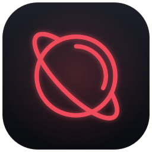
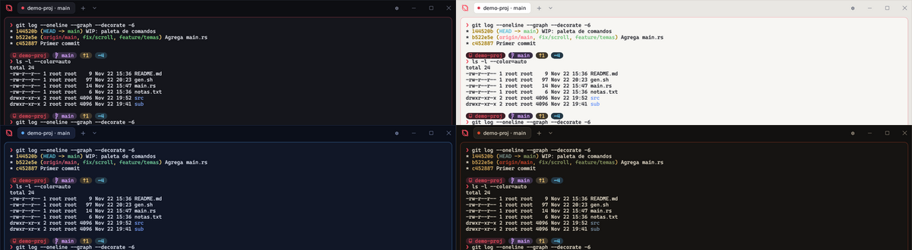
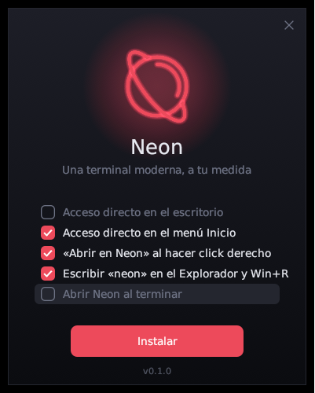
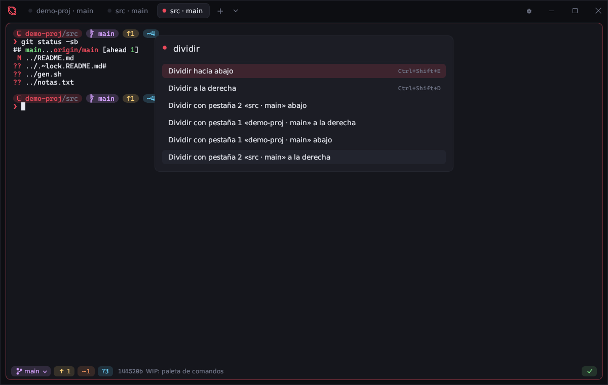
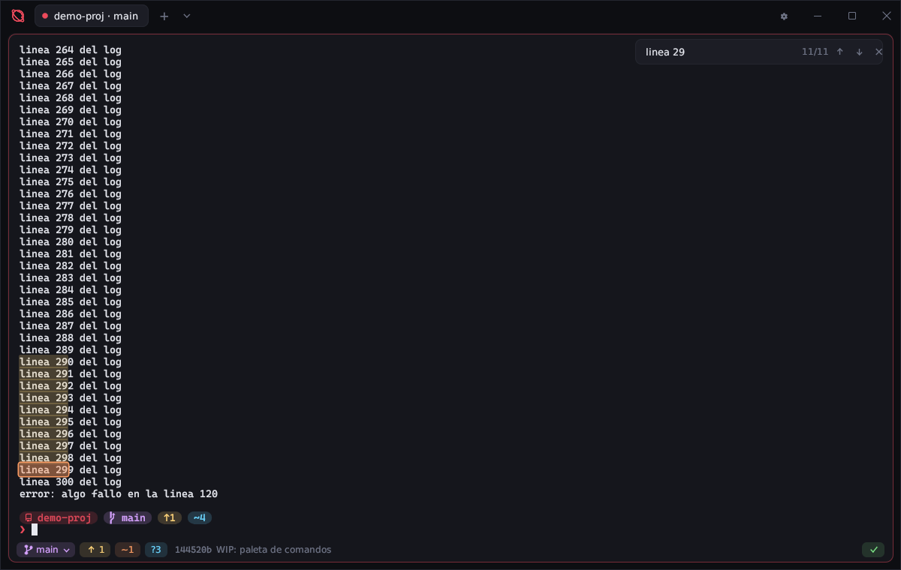

<div align="center">



# Neon

**Una terminal moderna para Windows, hecha en Rust.**<br>
Pestañas y paneles que se arrastran, historial inteligente, git a la vista y un diseño pensado para que dé gusto usarla.

<p>
  <a href="https://github.com/T013D0/Neon-Terminal/releases/latest"></a>
  <a href="https://github.com/T013D0/Neon-Terminal/releases"></a>
  <a href="https://github.com/T013D0/Neon-Terminal/actions/workflows/release.yml"></a>
  
  
</p>

[Descargar](https://github.com/T013D0/Neon-Terminal/releases/latest) ·
[Características](#características) ·
[Instalación](#instalación) ·
[Atajos](#uso) ·
[Personalización](#personalización) ·
[Desarrollo](#desarrollo)

<br>


</div>

<br>

## Características

<table>
<tr>
<td width="50%" valign="top">

**Pestañas y paneles**<br>
Divide en cualquier dirección. Arrastra una pestaña para reordenarla, pegarla a un panel como división o sacarla a una ventana nueva, sin cortar la shell que tiene adentro. También puedes juntar dos pestañas abiertas con *Dividir con…*.

</td>
<td width="50%" valign="top">

**Historial inteligente**<br>
Cada comando queda guardado con su carpeta, repo, duración y si falló. `↑` abre la lista junto al cursor (lo de esta carpeta primero) y `Ctrl+R` busca por prefijo, texto o letras sueltas.

</td>
</tr>
<tr>
<td valign="top">

**Git a la vista**<br>
El prompt muestra el proyecto, la rama, commits por subir o bajar y archivos cambiados en cápsulas. Cada panel tiene una barra con el estado del repo y un menú para cambiar de rama.

</td>
<td valign="top">

**Paleta de comandos**<br>
`Ctrl+Shift+P` y escribes lo que quieres hacer: dividir, juntar pestañas, colorearlas, abrir otra shell, buscar actualizaciones… Todo está ahí, con su atajo al lado.

</td>
</tr>
<tr>
<td valign="top">

**Búsqueda y navegación**<br>
Busca en la salida con resaltado y contador, salta entre los prompts anteriores con `Ctrl+↑/↓`, copia la salida del último comando y abre links o rutas de archivo con `Ctrl+click`.

</td>
<td valign="top">

**Tuya de verdad**<br>
Cuatro temas (más los que importes de Windows Terminal), Mica y Acrylic, opacidad, letra ajustable y atajos que puedes cambiar desde Ajustes.

</td>
</tr>
<tr>
<td valign="top">

**Varias shells**<br>
PowerShell, Símbolo del sistema, Git Bash y WSL, cada una con su prompt, y las pestañas con su color y nombre. Al cerrar se guarda la sesión y se recupera al abrir.

</td>
<td valign="top">

**Integrada con Windows**<br>
Escribe `neon` en la barra de direcciones del Explorador, o usa *Abrir en Neon* con click derecho en una carpeta. Avisa cuando termina un comando largo y se actualiza sola desde GitHub.

</td>
</tr>
</table>

<div align="center">

<br><sub>Brasa · Brasa claro · Medianoche · Sumi</sub>
</div>

## Instalación

### Descargar el instalador (recomendado)

1. Ve a [**Releases**](https://github.com/T013D0/Neon-Terminal/releases/latest) y descarga **`NeonSetup.exe`**.
2. Ábrelo y elige qué integrar con Windows. No pide permisos de administrador: todo es para tu usuario.

> [!NOTE]
> El instalador no está firmado digitalmente, así que Windows SmartScreen puede mostrar un aviso la primera vez.
> Pulsa **Más información → Ejecutar de todas formas**.

Necesitas Windows 10 o 11 de 64 bits. La fuente (Caskaydia Mono Nerd Font) ya viene incluida en Neon.

<div align="center">

</div>

El instalador tiene tres pantallas:

| Pantalla | Qué hace |
|---|---|
| **Bienvenida** | Primera vez. Casillas para elegir qué integrar: acceso directo en el escritorio y en el menú Inicio, *Abrir en Neon* en el click derecho, `neon` en el Explorador y `Win+R`, y abrir Neon al terminar. |
| **Ya instalado** | Muestra la versión instalada. **Actualizar** si el instalador trae una más nueva, o **Reparar** (vuelve a copiar Neon y a registrar todo según las casillas). |
| **Desinstalar** | Pide confirmación. La casilla *Borrar también mi historial y ajustes* viene apagada: sin marcarla, `%LOCALAPPDATA%\neon` se conserva. |

Además queda una entrada en **Configuración → Aplicaciones** con su botón Desinstalar.

### Compilar desde el código

Necesitas [Rust](https://rustup.rs) (con las *Build Tools* de Visual Studio) y `git`.

```powershell
git clone https://github.com/T013D0/Neon-Terminal.git
cd Neon-Terminal
.\build-installer.cmd        # genera dist\NeonSetup.exe
```

O sin instalador:

```powershell
cargo build --release
.\target\release\neon.exe --instalar
```

<details>
<summary><b>Opciones de línea de comandos</b></summary>

<br>

| Comando | Efecto |
|---|---|
| `neon` | Abre Neon y restaura la sesión anterior. |
| `neon C:\ruta` · `neon .` | Abre Neon en esa carpeta (no toca la sesión guardada). |
| `neon --instalar` | Instala para el usuario actual. Acepta `--escritorio`, `--sin-inicio`, `--sin-menu`, `--sin-explorador` y `--silencioso`. |
| `neon --instalar --mantener` | Actualiza dejando la integración como está (lo usa la actualización automática). |
| `neon --desinstalar` | Desinstala. Con `--borrar-datos` borra también historial y ajustes. |

</details>

## Uso

<div align="center">

</div>

### Atajos

Todos se pueden cambiar en **Ajustes → Atajos**.

| Atajo | Acción |
|---|---|
| `Ctrl+Shift+P` | Paleta de comandos |
| `Ctrl+,` | Ajustes |
| `Ctrl+Shift+T` · `Ctrl+Shift+W` | Nueva pestaña (misma carpeta) · cerrar panel |
| `Ctrl+Shift+N` | Nueva ventana |
| `Ctrl+Tab` · `Ctrl+Shift+Tab` · `Ctrl+1…9` | Cambiar de pestaña |
| `Ctrl+Shift+D` · `Ctrl+Shift+E` | Dividir a la derecha · hacia abajo |
| `Alt+←↑↓→` | Mover el foco entre paneles |
| `Alt+Shift+←↑↓→` | Agrandar o achicar el panel |
| `Ctrl+Shift+Enter` | Maximizar o restaurar el panel |
| `Ctrl+Shift+F` | Buscar en la salida (`Enter` anterior · `Shift+Enter` siguiente · `Esc` cierra) |
| `Ctrl+↑` · `Ctrl+↓` | Saltar al prompt anterior · siguiente |
| `↑` en el prompt | Historial junto al cursor |
| `Ctrl+R` | Buscador de historial (`Enter` ejecuta · `Tab` deja escrito para editar) |
| `Ctrl+Shift+O` | Copiar la salida del último comando |
| `Ctrl+Shift+C` · `Ctrl+Shift+V` | Copiar · pegar |
| `Ctrl+=` · `Ctrl+-` · `Ctrl+0` | Letra más grande · más chica · normal |
| `Ctrl+click` | Abrir un link, o un archivo en VS Code en esa línea (`ruta:12`) |

### Con el mouse

- **Pestañas:** click para cambiar, click medio para cerrar, doble click para renombrar. El click derecho abre un menú para renombrar, **elegir color**, **dividir con otra pestaña**, mover a una ventana nueva o cerrar.
- **Arrastrar una pestaña:**
  - a la barra de pestañas, de esta u otra ventana: la mueve;
  - sobre un panel: se pega a ese lado como división (se marca dónde caería);
  - fuera de las ventanas: se abre en una ventana nueva.
- **Click derecho en la terminal:** copiar, pegar, buscar, dividir, limpiar y cerrar panel.
- **`+` y `▾`:** nueva pestaña con la shell predeterminada, o con la que elijas de la lista.
- **Ventana:** el espacio vacío de la barra de pestañas la mueve, el doble click la maximiza y se estira desde cualquier borde.

<div align="center">

</div>

## Personalización

Abre **Ajustes** con `Ctrl+,` (o el engranaje de la barra). Los cambios se guardan solos.

<div align="center">

</div>

| Sección | Qué puedes cambiar |
|---|---|
| **Apariencia** | Tema, tamaño de letra, fondo (Sólido, Mica o Acrylic) y opacidad. Puedes **importar un esquema de Windows Terminal** pegando su JSON. |
| **Terminal** | Shell predeterminada, líneas de scrollback, restaurar sesión y prompt de Neon. |
| **Avisos** | Notificaciones al terminar comandos largos (y a partir de cuántos segundos) y confirmar antes de cerrar algo que está corriendo. |
| **Atajos** | Cambiar o quitar cualquier atajo; avisa si choca con otro. |
| **Actualizaciones** | Buscar ahora y activar o no el chequeo automático. |
| **Avanzado** | Abrir `settings.toml` o la carpeta de datos, y restaurar los ajustes. |

Todo vive en `%LOCALAPPDATA%\neon\settings.toml`. Si lo editas a mano, Neon lo recarga al guardar:

```toml
theme = "Brasa"          # Brasa, Brasa claro, Medianoche, Sumi o uno importado
font_size = 14.0
scrollback = 10000
restore_session = true
neon_prompt = true       # prompt con cápsulas; false usa el de tu shell
confirm_close = true
notify = true
notify_after_secs = 10
backdrop = "Ninguno"     # "Mica" o "Acrylic" en Windows 11
opacity = 1.0
check_updates = true

[keys]
new_tab = "Ctrl+Shift+T"
```

Si usas oh-my-posh o starship, Neon respeta tu prompt; para desactivar el suyo define `NEON_PROMPT=0`.

## Claude Code

Neon trae ayudas para usar el CLI de Claude Code (todas se pueden apagar en Ajustes → Terminal):

- **Shift+Enter** inserta un salto de línea mientras corre `claude`.
- **Avisos**: si suena la campana en un panel que no miras, Neon muestra una notificación de Windows, parpadea la barra de tareas y marca la pestaña. Para que Claude Code toque la campana, usa `"preferredNotifChannel": "terminal_bell"` en `~/.claude/settings.json`.
- **Pestañas con actividad**: punto pulsante si el título indica que Claude trabaja, punto claro si hubo salida nueva y punto rojo si te necesita.
- **Ctrl+V inteligente**: pega texto, rutas de archivos copiados en el Explorador, y si solo hay una imagen se la entrega a Claude Code (Alt+V).
- **Arrastrar archivos** desde el Explorador escribe su ruta (con comillas si tiene espacios).
- **Rueda del mouse** en la pantalla completa de Claude Code hace scroll en vez de recorrer el historial.
- **Seleccionar copia** automáticamente y el clic central pega, como en Linux.
- Símbolos como ⏺ ⎿ ✻ se ven con una fuente de respaldo.

## Actualizaciones

Neon busca versiones nuevas en los [Releases](https://github.com/T013D0/Neon-Terminal/releases) de este repositorio, como mucho una vez al día. Si hay una, aparece un botón **↑ v0.2.0** en la barra y un aviso.

**Actualizar ahora** descarga `NeonSetup.exe`, comprueba su SHA-256, cierra Neon, lo actualiza **sin preguntar y sin tocar lo que quitaste** (accesos directos, menú contextual) y lo vuelve a abrir con tu sesión restaurada.

- Solo descarga desde `github.com`. Si el SHA-256 no coincide, descarta el archivo.
- Usa `curl`, que ya viene con Windows 10 y 11. Sin internet, el chequeo automático falla en silencio.
- También puedes buscar a mano: Ajustes → Actualizaciones, o la paleta → *Buscar actualizaciones*.

## Cómo funciona

<details>
<summary><b>Arquitectura y estructura del proyecto</b></summary>

<br>

Una terminal solo recibe texto: no sabe qué comando ejecutaste. Por eso cada shell arranca con un pequeño script (`src/shell.rs`) que, cada vez que se dibuja el prompt, escribe una línea JSON en un archivo de esa sesión con el comando, la carpeta y si salió bien. La app lee ese archivo y de ahí salen el historial, el estado de git y las notificaciones. Todas las ventanas viven en el mismo proceso (viewports de egui), así una pestaña pasa de una a otra sin cortar su shell.

La emulación viene de [`alacritty_terminal`](https://github.com/alacritty/alacritty), el dibujo de [`egui`](https://github.com/emilk/egui) y los paneles divididos de [`egui_tiles`](https://github.com/rerun-io/egui_tiles).

```
src/
  main.rs        arranque (restaurar sesión o abrir en una carpeta)
  app.rs         ventanas, arrastrar y soltar, atajos, paleta, historial, avisos
  commands.rs    todas las acciones (atajos, paleta y menús usan las mismas)
  workspace.rs   pestañas y su árbol de paneles: dividir, mover, navegar
  ui.rs          piezas de interfaz: paneles, barra inferior, cápsulas, pestañas
  pane.rs        un panel = una shell + sus eventos + git + búsqueda + links
  profiles.rs    perfiles de shell: PowerShell, cmd, Git Bash, WSL
  session.rs     guardar y restaurar la sesión
  shell.rs       integración con PowerShell/bash/cmd: prompt, colores, eventos
  history.rs     SQLite + ranking del historial
  git.rs         consulta a git en segundo plano
  settings.rs    ajustes (settings.toml) y atajos
  settings_ui.rs pantalla de Ajustes
  theme.rs       colores, fuentes y estilo
  themes.rs      temas incluidos e importación desde Windows Terminal
  install.rs     --instalar / --desinstalar: registro, accesos directos, menú contextual
  update.rs      actualizaciones desde GitHub Releases
  window.rs      esquinas redondeadas, borde, Mica/Acrylic (Windows)
installer/       NeonSetup.exe: el instalador animado (lleva neon.exe adentro)
crates/egui_term widget de terminal (copia de egui_term 0.1.0 con arreglos)
assets/          logo, íconos, capas del instalador y la fuente
.github/         workflow que publica NeonSetup.exe al subir un tag
```

`crates/egui_term` es una copia de [egui_term](https://github.com/Harzu/egui_term) (MIT) con cambios marcados como `Patched (neon)`: el teclado funciona aunque el mouse no esté sobre el panel, Tab/flechas/Esc no se escapan a otros controles, se pueden pasar variables de entorno a la shell y los links (también rutas de archivo) los abre Neon.

</details>

## Limitaciones conocidas

- **Símbolo del sistema (cmd)** no permite saber qué comandos se ejecutan: ahí no hay historial con `↑`, ni copiar salida, ni git abajo (el prompt con colores sí).
- **WSL:** el prompt muestra git normalmente, pero la barra inferior del panel puede no hacerlo (usa el git de Windows sobre `\\wsl.localhost\…`).
- **Mica y Acrylic** necesitan Windows 11 (22H2 o más nuevo). En Windows 10 el fondo se ve sólido.
- **Notificaciones:** sin instalar (con el `.exe` suelto) salen como «Windows PowerShell»; con el instalador salen como Neon.
- Para borrar la línea antes de escribir un comando del historial se usa `Esc` en PowerShell y cmd, y `Ctrl+E Ctrl+U` en bash. Con PSReadLine en modo Emacs o Vi, cambia `ProfileKind::clear_line` en `src/profiles.rs`.
- Sin ligaduras ni imágenes en la terminal. Al no usar la barra de título nativa no aparece el menú *Snap layouts* de Windows 11 (`Win+Z` y arrastrar a los bordes siguen funcionando).

## Desarrollo

```powershell
cargo run                      # compilar y abrir
cargo test                     # tests (historial, git, ajustes, temas, actualizaciones…)
cargo fmt --all
```

Para trabajar sobre el código, `cargo run -- C:\ruta\a\un\proyecto` abre Neon en esa carpeta sin tocar tu sesión guardada.

### Publicar una versión

El workflow [`release.yml`](.github/workflows/release.yml) compila en Windows y adjunta `NeonSetup.exe` al release.

```powershell
# 1. Cambia `version` en [workspace.package] de Cargo.toml (por ejemplo "0.2.0") y haz commit
git tag v0.2.0
git push --tags
```

El tag tiene que coincidir con la versión de `Cargo.toml`; si no, el workflow falla a propósito. Neon y su instalador comparten esa única versión. Para que el workflow pueda crear el release, activa **Settings → Actions → General → Workflow permissions → Read and write**.

## Créditos

Hecho con [egui](https://github.com/emilk/egui)/[eframe](https://github.com/emilk/egui/tree/master/crates/eframe), [alacritty_terminal](https://github.com/alacritty/alacritty), [egui_tiles](https://github.com/rerun-io/egui_tiles), [egui_term](https://github.com/Harzu/egui_term) y [rusqlite](https://github.com/rusqlite/rusqlite).
La fuente incluida es [Cascadia Code](https://github.com/microsoft/cascadia-code) en su versión Nerd Font (Caskaydia Mono), con licencia SIL OFL 1.1 (`assets/fonts/OFL-CascadiaCode.txt`).
